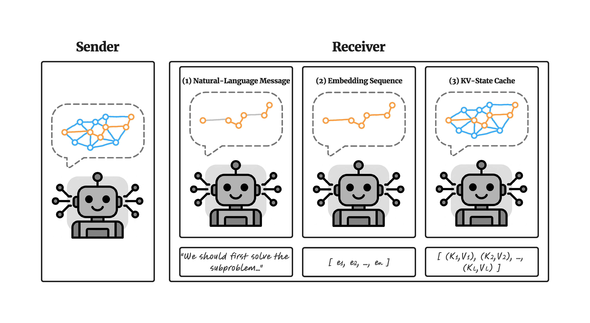
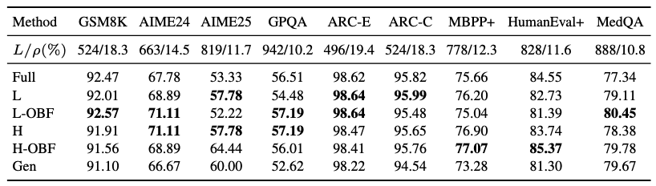
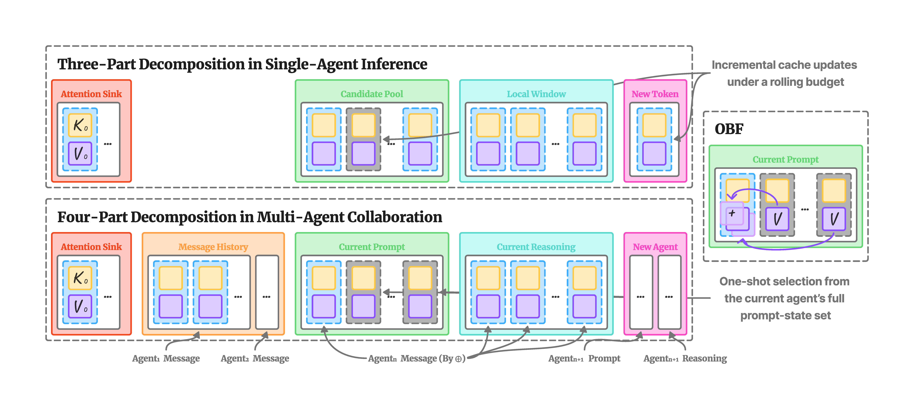

<a name="readme-top"></a>

# When Less Latent Leads to Better Relay: Information-Preserving Compression for Latent Multi-Agent LLM Collaboration

## 📚 Citation


```bibtex
@article{li2026when,
  title={When Less Latent Leads to Better Relay: Information-Preserving Compression for Latent Multi-Agent LLM Collaboration},
  author={Li, Yiping and An, Zhiyu and Du, Wan},
  year={2026}
}
```
**Links:** `Paper (arXiv): coming soon`


This repository studies **KV-cache compression for latent-state communication in multi-agent LLM systems**. In **LatentMAS**, agents relay **transformer KV caches** instead of natural-language messages, which preserves richer internal state but makes inter-agent communication memory- and bandwidth-heavy. We adapt eviction-style KV compression to this relay setting and introduce **OrthoBackfill (OBF)**, a lightweight value-only correction that reinjects the orthogonal residual lost under hard eviction.

The central result is that **better relay does not necessarily require more KV**. Under a fixed prompt-state relay budget, compressed variants can match or outperform full KV relay, and OBF-enhanced methods deliver the strongest overall results across most benchmarks.

**Current support:** the maintained execution path is `--method latent_mas` with `--prompt sequential`. `baseline` and `text_mas` remain in the [methods](./methods) folder for reference, but are not currently supported.

## 🌐 Overview

Recent MAS work is moving from **text messages** to **continuous internal-state communication**. That shift improves fidelity, but it also makes communication substantially more expensive once agents begin passing full KV caches instead of decoded tokens.

LatentMAS sits at the high-fidelity end of this spectrum. Our goal is to make that communication practical: compress the relayed KV cache aggressively enough to reduce cost, while still preserving the latent information that downstream agents need in order to continue reasoning.



This repository focuses on three questions:

- Which prompt KV states should be relayed to the next agent?
- How should single-agent eviction rules be adapted to multi-agent latent relay?
- What information is lost under hard eviction, and how can that loss be compensated?

## 📊 Main Results

Under a fixed relay budget of **32 prompt states per agent round**, compressed relay is not merely competitive with full KV relay. In our experiments, **at least one compressed method outperforms full relay on all 9 benchmarks**, and **OBF variants achieve the best result on 7 of 9 benchmarks**.



Key takeaways:

- Relay quality depends on **which KV states are kept**, not only on how much KV is transmitted.
- Eviction can act as a useful form of **denoising**, rather than only as an approximation.
- OBF often makes sparsified relay **more usable for downstream continuation**, not just more complete.

## 🧠 Method Overview

### 1. From full relay to selective relay

In LatentMAS, each agent inherits the previous agent's KV message and appends its own local states. That means relay cost grows with interaction depth. We reformulate standard KV eviction for this setting by separating the cache into:

- a shared **attention sink**
- **inherited message history**
- the current agent's **prompt context**
- the current agent's **latent reasoning states**

The compression step acts on the current agent's local prompt states, while inherited relay memory is passed forward.



### 2. Eviction baselines for LatentMAS

We evaluate two adapted relay baselines:

- **MAS-StreamingLLM / Gen**: keep the global sink and newly generated reasoning states.
- **MAS-H2O**: keep prompt states with the highest attention-based importance under layer-wise or head-wise scoring.

These baselines test whether standard long-context eviction ideas remain effective when the KV cache becomes the communication medium between agents.

### 3. OrthoBackfill (OBF)

Hard eviction can remove prompt-side information that is still useful for the next agent, especially when that information is distributed across discarded states instead of tied to a single retained token. OBF addresses this by:

1. splitting prompt values into **kept** and **discarded** sets
2. projecting discarded values onto the span of retained values
3. isolating the **orthogonal residual** that the retained span cannot represent
4. compressing that residual in a low-rank principal subspace
5. injecting the resulting value-only correction back into retained prompt values

OBF is deliberately conservative: it does **not** try to reconstruct everything that was dropped. It only backfills the part of the discarded signal that is not already expressible by the retained-value span.


## 🧪 Supported Tasks

Current `run.py` supports the following benchmarks:

- `gsm8k`
- `aime2024`
- `aime2025`
- `gpqa`
- `arc_easy`
- `arc_challenge`
- `mbppplus`
- `humanevalplus`
- `medqa`

## ⚙️ Setup

Optional cache location:

```bash
export HF_HOME=/path/to/huggingface
export TRANSFORMERS_CACHE=$HF_HOME
export HF_DATASETS_CACHE=$HF_HOME
```

Install dependencies:

```bash
conda create -n compressed_latentams python=3.10 -y
conda activate compressed_latentams
pip install -r requirements.txt
```

Optional logging:

```bash
pip install wandb
```

## 🚀 Quick Start

Clone the repository:

```bash
git clone <your-repo-url>
cd CompressedLatentMAS
```

Run full KV relay:

```bash
python run.py \
  --method latent_mas \
  --model_name Qwen/Qwen3-8B \
  --task gsm8k \
  --prompt sequential \
  --compressor full \
  --latent_steps 20 \
  --generate_bs 1 \
  --max_samples 20
```

Run an eviction baseline:

```bash
python run.py \
  --method latent_mas \
  --model_name Qwen/Qwen3-8B \
  --task gsm8k \
  --prompt sequential \
  --compressor layerwise \
  --latent_steps 20 \
  --generate_bs 1 \
  --max_samples 20
```

Run an OBF-enhanced variant:

```bash
python run.py \
  --method latent_mas \
  --model_name Qwen/Qwen3-8B \
  --task gsm8k \
  --prompt sequential \
  --compressor lobf \
  --latent_steps 20 \
  --generate_bs 1 \
  --max_samples 20
```

Important flags:

- `--latent_steps`: latent rollout steps for each non-judger agent
- `--compressor`: KV relay operator used between agent rounds
- `--prompt`: use `sequential` in the currently supported path
- `--generate_bs`: batch size for evaluation

## 🧩 Available Compressors

The current `run.py` path supports the following compressor names:

- `full`
- `gonly`
- `headwise`
- `layerwise`
- `lobf`
- `lobf_metric`
- `lobf_navie`
- `lobf_no_proj`
- `lobf_no_scale`
- `lobf_max_p`
- `hobf`

For practical evaluation, the most relevant path is:

1. `full`
2. `gonly`, `headwise`, `layerwise`
3. `lobf`, `hobf`

## 📝 Output and Logging

Each run writes per-sample JSONL records to `--output_folder`, including:

- prediction and gold label
- correctness
- agent traces
- communication overhead
- runtime metrics
- OBF diagnostic metrics when available

Enable Weights & Biases logging with:

```bash
--use_wandb
```

## 📌 Notes

- This repository is currently focused on `--method latent_mas`.
- The supported experiment path in this fork is the **sequential LatentMAS** setup.
- `baseline` and `text_mas` are present in [methods](/Users/xxivmk/GitHub/LatentMAS/methods) but are currently not supported.
- Some parser options or legacy modules still exist in the tree, but this README documents only the actively supported path.
- Exact reproduction can depend on model version, seed, and compression hyperparameters.

## Adaptive Budget Routing (Experimental)

This fork includes an experimental `BudgetRouter` integration for head-wise
compression. The original HOBF selector and OBF compensation are unchanged;
only the prompt-KV budget can vary at each handoff.

Run the original fixed-budget baseline explicitly:

```bash
python run.py \
  --method latent_mas \
  --model_name Qwen/Qwen3-4B \
  --task gsm8k \
  --split test \
  --compressor hobf \
  --budget_policy fixed \
  --kv_budget 32 \
  --generate_bs 1
```

Smoke-test the integrated router with deterministic random initialization:

```bash
python run.py \
  --method latent_mas \
  --model_name Qwen/Qwen3-4B \
  --task gsm8k \
  --split test \
  --compressor hobf \
  --budget_policy router \
  --budget_choices 8 16 32 64 \
  --generate_bs 1 \
  --max_samples 5 \
  --seed 42
```

Without `--router_checkpoint`, the router is untrained. Its predictions are
useful only for validating the code path, not for reporting task performance.
Dynamic budgets currently require `--generate_bs 1` because each sample may
produce a different physical KV-cache length.

### Two-stage Router data collection

Do not exhaustively search the entire GSM8K training split. First screen a
reproducible random sample with the absolute-minimum schedule `(8, 8, 8)`:

```bash
python -u screen_router_candidates.py \
  --model_name Qwen/Qwen3-4B \
  --task gsm8k \
  --split train \
  --candidate_budgets 8 16 32 64 \
  --max_samples 500 \
  --hard_full_count 30 \
  --easy_full_count 20 \
  --output_folder router_data/gsm8k_screen \
  --resume
```

If `(8,8,8)` is correct, its three primary labels are exact because no other
schedule can have a lower total cost. Failed examples are high-value
candidates for non-minimum labels. The screening directory contains separate
correct/incorrect index files and `full_search_indices.txt`, which combines up
to 30 failed examples with a 20-example successful audit sample. Counts are
configurable; `-1` keeps every example in the corresponding group.

Run the exact 64-way Oracle only for those selected original dataset indices:

```bash
python -u collect_router_data.py \
  --model_name Qwen/Qwen3-4B \
  --task gsm8k \
  --split train \
  --candidate_budgets 8 16 32 64 \
  --sample_indices_file router_data/gsm8k_screen/full_search_indices.txt \
  --max_samples -1 \
  --output_folder router_data/gsm8k_joint_selected \
  --resume
```

All indices refer to the original dataset split, not to positions within the
random screening sample. Keep every state derived from one source question in
the same train/validation partition. The official GSM8K test split must remain
untouched until final evaluation.

Generate exhaustive joint-Oracle training features and labels:

```bash
python collect_router_data.py \
  --model_name Qwen/Qwen3-4B \
  --task gsm8k \
  --split train \
  --candidate_budgets 8 16 32 64 \
  --reference_budget 32 \
  --latent_steps 20 \
  --max_samples 50 \
  --output_folder router_data/gsm8k_train \
  --resume
```

For an offline machine with a local Hugging Face snapshot, pass the snapshot
directory directly. A local directory automatically enables strict local-only
model and tokenizer loading; `--local_files_only` is included below to make the
intent explicit. The cache directory is also forwarded to the dataset loader.

```bash
python -u collect_router_data.py \
  --model_name /root/autodl-tmp/hf_cache/models--Qwen--Qwen3-4B/snapshots/1cfa9a7208912126459214e8b04321603b3df60c \
  --cache_dir /root/autodl-tmp/hf_cache \
  --local_files_only \
  --task gsm8k \
  --split train \
  --candidate_budgets 8 16 32 64 \
  --reference_budget 32 \
  --latent_steps 20 \
  --max_new_tokens 2048 \
  --max_samples 1 \
  --output_folder /root/autodl-tmp/router_data/gsm8k_joint_smoke \
  --device cuda
```

`run.py` accepts the same `--model_name`, `--cache_dir`, and
`--local_files_only` arguments for later router-checkpoint evaluation. In local
mode the tokenizer disables the unrelated Mistral-regex compatibility probe,
which otherwise may call the Hugging Face API in transformers 4.57 even when
the Qwen files are fully cached.

With four budget choices and three handoffs, the collector evaluates the full
Cartesian product: `4^3 = 64` complete rollouts per source example.  Candidate
comparisons use deterministic decoding and the same seed.  The global Oracle
first filters for correct final answers and then minimizes
`B0 + B1 + B2`.  All tied global optima are saved; a lexicographically smallest
canonical schedule supplies the three examples in `primary_examples`.

Each resumable `.pt` sample shard contains:

- `rollouts`: all 64 schedules, final outcomes, timing, and nominal costs;
- `global_oracle`: minimum cost, every tied optimum, and the canonical path;
- `primary_examples`: the three labels on the canonical global-optimum path;
- `reserve_state_examples`: all 21 budget-prefix states, including optimal
  action sets and per-action continuation costs;
- feature repeat-consistency diagnostics for states visited by several
  rollouts.

The first router experiment should train only on `primary_examples`.
`reserve_state_examples` is saved for a later data-expansion experiment and
contains at most 21 trainable labels per source example. A state for which no
continuation produces a correct final answer is retained with
`label_status=no_successful_descendant` and receives no hard class label.
If all 64 schedules fail, the source example has no primary labels.

`--resume` accepts only shards from this joint-Oracle schema. Use a new output
folder rather than mixing it with shards produced by the earlier 10-rollout
conditional-Oracle collector. The earlier collection loop remains commented
in `collect_router_data.py` so that the compromise design can be restored if
needed.

### Training BudgetRouter

Audit the merged, source-grouped dataset before training:

```bash
python train_budget_router.py \
  --screen_folder router_data/gsm8k_screen_500 \
  --exhaustive_folder router_data/gsm8k_joint_selected_50 \
  --output_folder router_training/gsm8k_primary_reserve \
  --view primary_reserve \
  --dry_run
```

The merge uses certified primary states for screened minimum-budget successes
and exhaustive reserve states when available. It excludes states with no
successful descendant and deduplicates by `(source question, budget prefix)`.
Source questions, rather than individual states, are split between training
and validation. Tied Oracle actions use a multi-positive objective. Class and
handoff support weights prevent the abundant `B=8` and final-handoff states
from dominating every update.

Train the first augmented Router after checking `setup.json`:

```bash
python train_budget_router.py \
  --screen_folder router_data/gsm8k_screen_500 \
  --exhaustive_folder router_data/gsm8k_joint_selected_50 \
  --output_folder router_training/gsm8k_primary_reserve \
  --view primary_reserve \
  --epochs 100 \
  --patience 15 \
  --batch_size 128 \
  --learning_rate 1e-3 \
  --device cuda
```

Run the same command with `--view primary` and a separate output directory for
the primary-only ablation. The best checkpoint is `best_router.pt`; it embeds
the Router architecture metadata and can be passed directly to
`run.py --budget_policy router --router_checkpoint ...`.

### This Work

BibTeX for this work can be added once the paper metadata is finalized.

## 🙏 Acknowledgement

This codebase builds on LatentMAS and related work on long-context KV eviction, cache compression, and efficient LLM inference.
